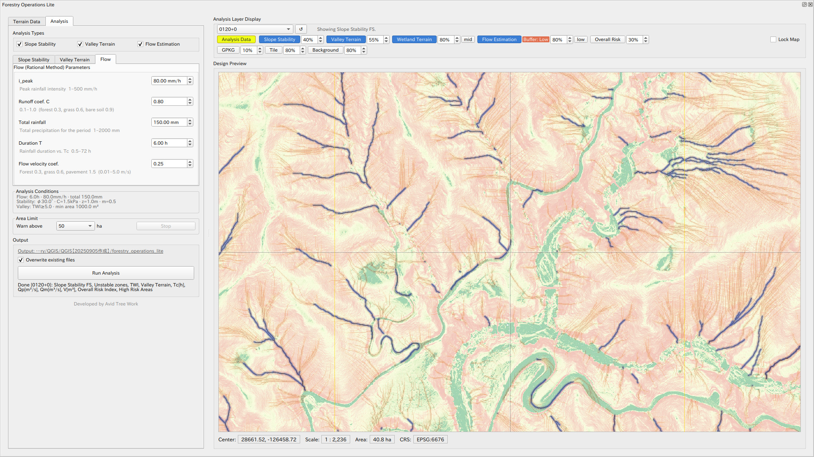
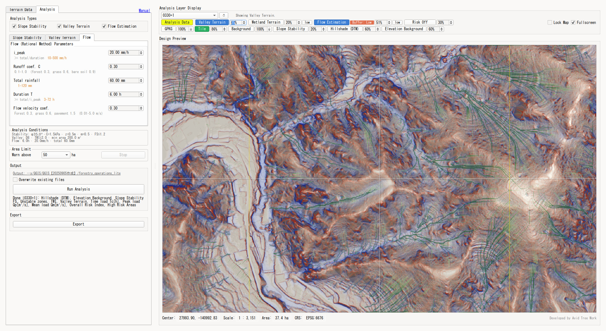
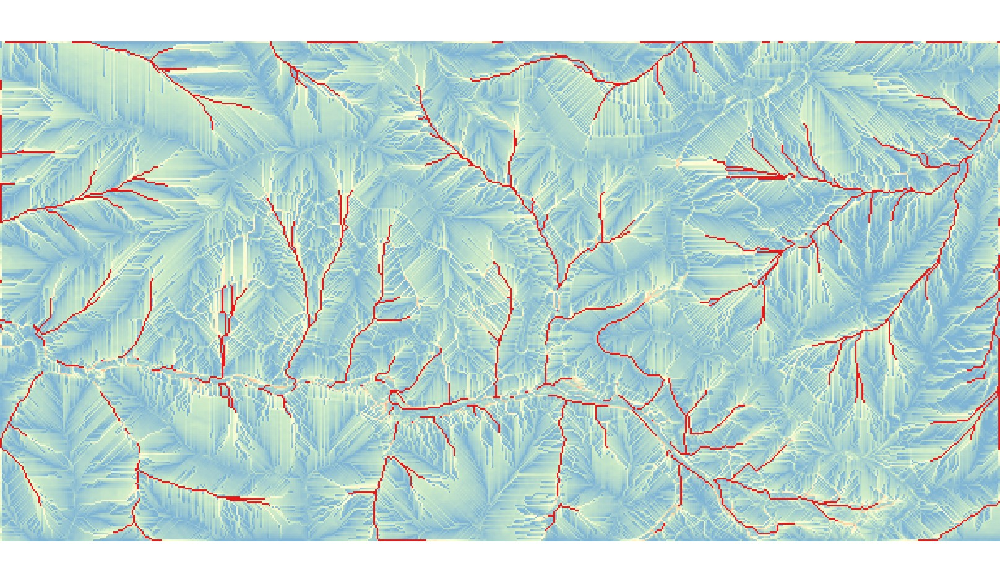
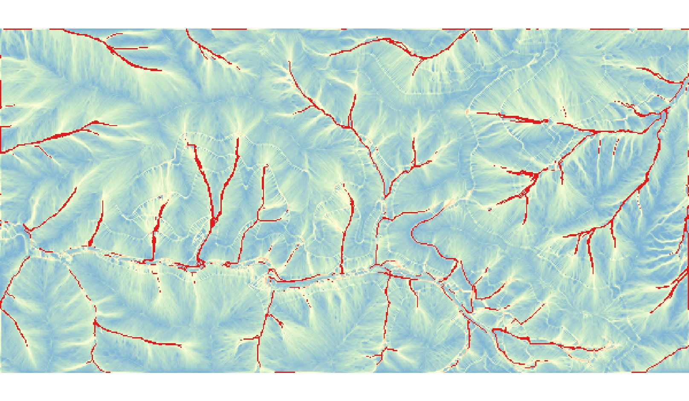
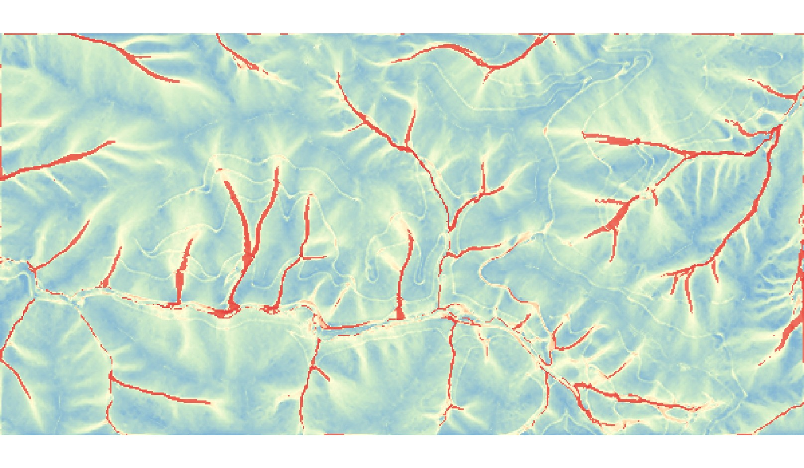

# Forestry Operations Lite

A QGIS plugin for terrain analysis supporting forestry site assessment.



---

## Features

- Load DEM from local files or online sources (GSI elevation tiles for Japan; AWS Terrarium for global coverage; high-resolution open data for the Netherlands, France and New Zealand)
- Optional DSM — aligned to the analysis DEM grid; canopy height sets flow coefficients where DSM is valid, and editable fallback coefficients cover missing DSM cells. Each run records DSM coverage and applied settings in `params.json` and Analysis Conditions.
- Compute **slope stability** (infinite-slope factor of safety), **TWI** (Topographic Wetness Index), **valley terrain**, and **flow estimation**
- Export a **CS MAP** terrain visualization from the current DEM extent, with optional direct assignment to Layer Settings > Tile Layer
- Preview canvas with bidirectional sync to the QGIS main map window
- Layer settings (background / tile / GPKG) displayed in the preview independent of analysis data
- Map lock: fix the preview to the analysis extent while continuing to navigate the main window freely
- Analysis results are grouped and managed by run number in the QGIS layer panel
- Preview status bar shows centre coordinates, scale, area (ha), and CRS
- Analysis, DEM/DSM fetching, CS MAP export and WebODM Importer export run in the background, so QGIS stays responsive; analysis shows the current step and the estimated time remaining
- Running tasks can be stopped with **Stop** / **Cancel**; switching projects or closing the plugin window cancels a running task and removes its partial files


---

## CS MAP Export

Use **Run Export** under **Terrain Data > CS Map Export** to create a CS-style terrain map from the selected DEM. Local DEM files are exported as a whole raster; fetched sources such as VS LP/Grid, GSI DEM, and Terrarium use the currently fetched DEM raster. The output file name is derived from the exported area's center coordinate and size, so exports of different areas never collide or overwrite one another. When **Overwrite Same Location** is checked (default), re-exporting the same area replaces the previous file for that location; unchecked, each re-export of that same area is kept as a separate file instead. The export is always added to QGIS; when **Set As Layer** is checked, it is also set as the current **Layer Settings > Tile Layer** selection so it appears in the preview as a base terrain layer.

> **Note:** The color balance is tuned for Forestry Operations Lite so analysis layers such as flow, wetness, and terrain features remain easy to interpret.



The CS立体図 method was proposed by Nagano Prefecture Forestry Research Center. The method is described as open, but exported maps also depend on the license and attribution requirements of the input DEM.

---

## Flow Direction Method (Valley / TWI)

The Valley Terrain analysis lets you choose how water flow is routed across the DEM when computing TWI and delineating valley zones. The choice is applied **to the Valley/TWI computation only** — flow estimation always uses D8. The three options trade off between a crisp channel line and a faithful wetness surface.

> ℹ️ **The images below are illustrative comparisons of how each method behaves — not analysis deliverables.** They were rendered on a sample DEM (resampled to 2 m) purely to show the difference; your actual output rasters/vectors are produced by running the analysis.

*Example renders on a sample DEM — for comparison only, not plugin outputs.*

| D8 | D∞ | MFD |
|---|---|---|
|  |  |  |
| **Single steepest** | **D-infinity** | **Multiple flow** |
| Water goes to one neighbour. Crisp single-line channels, but the TWI surface shows **striping artifacts**. | Flow split between two neighbours. **No striping**, valleys stay fairly sharp — a balanced middle ground. | Flow spread to all downslope cells. **Smoothest wetness surface**; valley zones follow the true valley bottom but look wider/fuzzier. |
| Best for **pinpointing where water concentrates** (danger lines, routing roads to avoid channels). | Best when you want **both a readable line and an artifact-free surface**. | Best for reading the **valley terrain itself** as a faithful area (wetness / disaster-risk surface). |

> **Note:** The TWI threshold that best separates valleys differs by method (the accumulation scale changes). Re-check the *TWI Threshold* after switching methods. In the example above, matching valley density required TWI ≈ 5.2 (D8), 5.4 (D∞), 5.9 (MFD).

---

## Virtual Shizuoka Features (Shizuoka Prefecture, Japan only)

These features use Virtual Shizuoka open data hosted on AWS S3 and are not available outside Shizuoka Prefecture.

- **VS LP/Grid 0.5 m DEM** — auto-fetched from S3 for the current canvas extent
- **Auto DSM** — selecting VS LP/Grid as DEM automatically fetches and sets VS LP/Ground as DSM; no manual DSM selection is needed
- **Export for WebODM Importer** — packages DTM, DSM and ortho into a ZIP for use with the [WebODM Importer](https://github.com/raw-slnc/webodm_importer) plugin (see [Export for WebODM Importer](#export-for-webodm-importer))

### VS LP/Grid workflow

1. Click **Browse** under DEM Data and select **VS LP/Grid (0.5m)**
2. DEM tiles are fetched from S3 for the current canvas extent
3. Immediately after, DSM (VS LP/Ground LAS → GeoTIFF) is fetched automatically for the same extent
4. The DSM browse button is disabled while VS LP/Grid is active (DSM is managed automatically)
5. **Cancel** on the DEM row cancels both DEM and DSM operations
6. **Clear** on the DEM row clears both DEM and DSM

---

## Export for WebODM Importer

The **Export for WebODM Importer** section packages the loaded terrain data into a ZIP that the [WebODM Importer](https://github.com/raw-slnc/webodm_importer) plugin can load directly.

**Requirements:**
- WebODM Importer plugin must be installed (controls are disabled otherwise)
- DEM source is one of: VS LP/Grid (Shizuoka), AHN4 DTM (Netherlands), IGN LiDAR HD MNT (France), LINZ DEM 1m (New Zealand)
- DSM is optional for every source (it is included when DSM Data is set)

**Buttons:**
- **Export** is enabled once the requirements are met, and greyed out while the exported ZIP is still valid
- **Open in WODMI** is enabled once a ZIP has been exported and stays enabled until the DTM or DSM changes (a new selection, Clear, or a re-fetch) or the ZIP is deleted
- **Cancel** stops an export in progress

**What is included in the ZIP:**

| Source | DTM | DSM (if set) | Ortho |
|---|---|---|---|
| VS LP/Grid | VS LP/Grid (0.5 m) | VS LP → DSM (0.5 m) | VS LP/Ortho for the same tile range (skipped if not available) |
| AHN4 DTM | AHN4 DTM (0.5 m) | AHN4 DSM (0.5 m) | PDOK Luchtfoto 2021 (resampled to 0.25 m) |
| IGN LiDAR HD MNT | IGN LiDAR HD MNT (0.5 m) | IGN LiDAR HD MNS (0.5 m) | IGN BD ORTHO from the year closest to the LiDAR survey (0.25 m) |
| LINZ DEM 1m | LINZ DEM (1 m) | — (no DSM source yet) | LINZ aerial imagery from the survey closest to the DEM survey (0.25 m) |

- For the Netherlands, France and New Zealand, the orthophoto is cut to the DTM extent and grid, and the ZIP also contains `DATA_SOURCES.txt` with the data list, acquisition dates, sources and licences. The confirmation and completion dialogs show the same acquisition dates, and a note is shown when the orthophoto and the elevation data were acquired in different years or the orthophoto does not cover the whole area.
- Point clouds are not put into the ZIP. For VS LP/Grid, `las_sources.json` refers to the LAS files that were downloaded to create the DSM (`vs_lp_ground/`), and `README_LAS_LINKS.txt` lists their download URLs. For the other sources `las_sources.json` is written with an empty list.

Use the **Open in WODMI** button to open the exported ZIP directly in the WebODM Importer panel.

---

## DEM Sources

| Source | Coverage | Resolution | Notes |
|--------|----------|------------|-------|
| GSI DEM1A | Japan | ~1 m | Auto-fetched from canvas extent |
| GSI DEM5A | Japan | ~5 m | Auto-fetched from canvas extent |
| GSI DEM10B | Japan | ~10 m | Auto-fetched from canvas extent |
| AWS Terrarium | Worldwide | ~2–10 m eq. | Auto-fetched from canvas extent |
| Local file | Any | As-is | GeoTIFF, ZIP, or folder |
| Copernicus GLO-30 | Worldwide | 30 m | Free account required (OpenTopography) |
| VS LP/Grid | Shizuoka Pref., Japan | 0.5 m | Auto-fetched from S3 — see Virtual Shizuoka Features |
| Nagano Sabo Division R3-4 DEM | Nagano Pref., Japan | 0.5 m | Auto-fetched (HTTP Range) from G空間情報センター; DSM generated automatically from the same-year DCHM |
| Nagano Forestry Dept. DEM | Nagano Pref., Japan | 0.5 m | Auto-fetched (HTTP Range) from G空間情報センター; no DSM |
| AHN4 DTM / DSM | Netherlands | 0.5 m | PDOK WCS, EPSG:28992, CC0 |
| IGN LiDAR HD MNT / MNS | France (coverage still in progress) | 0.5 m | Géoplateforme WMS-R, EPSG:2154, Licence Ouverte (Etalab 2.0) |
| LINZ DEM | New Zealand | 1 m | COGs on AWS (nz-elevation), EPSG:2193, CC BY 4.0; requires a GDAL build with LERC support |

### Open data sources outside Japan

- The Netherlands, France and New Zealand sources are listed in the DEM / DSM browser only when the Design Preview overlaps that country.
- The DEM is fetched for the current Design Preview extent. For the Netherlands and France, the matching DSM (same survey) is then fetched automatically for the DEM extent. The DSM row can still be cancelled, cleared and fetched again on its own, and a DSM chosen later is also fetched for the DEM extent, so moving the map does not shift it.
- Clearing the DEM also clears the matching DSM.
- Fetched files are kept in `remote_dem/`. When a file fetched earlier from the same source already covers the needed extent, it is used without downloading again. Cached DEM/DSM files are kept while an analysis references them or they are currently loaded, and are removed after they are no longer referenced.
- The PDOK WCS can be slow, LiDAR HD does not yet cover all of France, and the LINZ copy on AWS may lag the latest LINZ release. These notes are also shown in the DEM browser.
- LINZ DEM tiles are LERC-compressed. If the GDAL bundled with QGIS cannot read LERC (for example the Flatpak build), the plugin says so and does not fetch.

### Re-fetching before analysis

For auto-fetched DEM sources (GSI, Terrarium, VS LP/Grid, Nagano, the Netherlands, France, New Zealand), the analysis uses the DEM already fetched. Only when the analysis area extends beyond it, the plugin asks whether to fetch it again; **OK** re-fetches the DEM (and the DSM, if set) and then runs the analysis, **No** cancels the run. Local DEM files are analysed on the overlapping part without asking.

### CRS recommendations

- Set the project CRS to the **UTM zone** covering your analysis area for best accuracy.
- UTM is valid up to ±84° latitude. Accuracy degrades above ±70° (Arctic/Antarctic regions are outside the intended use range).
- The plugin automatically corrects cell size for geographic CRS (EPSG:4326) and Web Mercator (EPSG:3857) inputs.

**UTM zone examples:**

| Region | Recommended CRS |
|--------|----------------|
| Japan (126–132°E) | EPSG:32653 |
| Japan (132–138°E) | EPSG:32654 |
| Japan (138–144°E) | EPSG:32655 |
| Peru / Bolivia (66–72°W) | EPSG:32719 |
| Peru / Bolivia (72–78°W) | EPSG:32718 |
| Southeast Asia | UTM zone for longitude |

---

## Requirements

- QGIS 4.0 or later
- Python 3.x (bundled with QGIS)
- numpy, GDAL, scipy (bundled with QGIS)

---

## Installation

1. Download the ZIP from [Releases](https://github.com/raw-slnc/forestry_operations_lite/releases)
2. In QGIS: **Plugins > Manage and Install Plugins > Install from ZIP**
3. The plugin appears in the **Raster toolbar** and **Raster menu**

---

## Usage

1. Click the **FOL** icon in the Raster toolbar to open the plugin window
2. Select a DEM source under **Terrain Data**
3. Set background / tile / GPKG layers under **Layer Settings**
4. Run terrain analysis — results are added to the QGIS layer panel grouped by run number
5. Toggle analysis layers on/off using the buttons in the preview panel

---

## Output Folder Structure

All output is written to `{project_folder}/forestry_operations_lite/`.
If the QGIS project has not been saved, `~/.qgis/forestry_operations_lite/` is used as a fallback.

```
forestry_operations_lite/
│
├── dem/                          # GSI / Terrarium tiles (GeoTIFF)
│   ├── gsi_dem5a_YYYYMMDD_HHMMSS.tif
│   └── gsi_dem5a_YYYYMMDD_HHMMSS_utm53.tif   ← reprojected to UTM
│
├── nagano_sabo_dem/              # Nagano Sabo Division DEM tiles — Nagano only (GeoTIFF)
├── nagano_dchm/                  # Nagano DCHM (canopy height) tiles — Nagano only
├── nagano_dsm/                   # DSM generated from DEM + DCHM — Nagano only
│   └── nagano_dsm_YYYYMMDD_HHMMSS.tif
├── nagano_rinmu_dem/             # Nagano Forestry Dept. DEM tiles — Nagano only (GeoTIFF)
│
├── remote_dem/                   # Netherlands / France / New Zealand DEM and DSM (GeoTIFF)
│   ├── ahn_dtm_YYYYMMDD_HHMMSS.tif
│   ├── ign_lidarhd_mns_YYYYMMDD_HHMMSS.tif
│   └── linz_dem_YYYYMMDD_HHMMSS.tif
│
├── vs_lp_grid/                   # VS LP/Grid DEM tiles — Shizuoka only (GeoTIFF)
│   ├── {tile_code}.tif
│   └── vs_grid_YYYYMMDD_HHMMSS.tif           ← merged (multi-tile)
│
├── vs_lp_ground/                 # VS LP/Ground DSM tiles — Shizuoka only
│   ├── {tile_code}.las                        ← raw LAS point cloud
│   ├── {tile_code}_dsm.tif                   ← converted DSM
│   └── vs_dsm_YYYYMMDD_HHMMSS.tif            ← merged (multi-tile)
│
├── zip/                          # Export ZIPs for WebODM Importer
│   ├── FOL_YYYYMMDD-all.zip
│   └── FOL_YYYYMMDD_2-all.zip                ← sequential if same day
│
├── cs_map/                       # Standalone CS MAP exports
│   ├── cs_map.tif                             ← overwrite mode
│   └── cs_map_YYYYMMDD_HHMMSS.tif             ← non-overwrite mode
│
└── {run_number}/                 # Analysis results (e.g. 0011, 0012, 0010+2)
    ├── params.json               ← analysis parameters
    ├── stability_fs.tif          ← slope stability factor of safety
    ├── unstable_zones.gpkg       ← FS < threshold polygons
    ├── twi.tif                   ← Topographic Wetness Index
    ├── valley_zones.gpkg         ← valley / wetland zones (TWI threshold)
    ├── tc.tif                    ← time of concentration [h]
    ├── flow_peak.tif             ← peak discharge Qp [m³/s]
    ├── flow_mean.tif             ← mean discharge Qm [m³/s]
    ├── integrated_risk_index.tif ← overall risk index (auto-generated)
    ├── integrated_high_risk_mask.tif ← display raster for high-risk areas
    └── integrated_high_risk.gpkg ← high-risk area polygons
```

**Run number format:** `{seq:3d}{n_files:1d}` (e.g. `0011` = run 001, 1 file).
When more than 9 files: `{seq}0+{n-10}` (e.g. `0010+2` = run 001, 12 files).


---

## License

This project is licensed under the GNU General Public License v2 or later.

---

## Support

If you find this plugin useful, your support is appreciated.
https://paypal.me/rawslnc

---

---

# Forestry Operations Lite（日本語）

林業サイトの地形解析を支援するQGISプラグインです。

---

## 機能

- ローカルファイルまたはオンラインのソース（国土地理院標高タイル・AWS Terrarium全球対応・オランダ／フランス／ニュージーランドの高精度オープンデータ）からDEMを読み込み
- DSMオプション — 解析用DEMのグリッドに合わせ、有効なDSMでは樹冠高から流出・流速係数を自動算出。欠損部は指定した補完係数を使用し、DSM適用率と使用条件を `params.json` と Analysis Conditions に記録・表示します。
- **斜面安定性**（無限斜面安全率）・**TWI**（地形湿潤指数）・**沢地形**・**流量推測**を計算
- 現在のDEM範囲から **CS MAP** 地形表現を出力し、Layer Settings > Tile Layer へ直接割り当て可能
- QGISメインマップとの双方向同期プレビューキャンバス
- 解析データの有無に関わらず、レイヤー設定（背景・タイル・GPKG）をプレビューに表示
- 地図ロック：解析範囲にプレビューを固定しながら、メインウィンドウは自由に操作可能
- 解析結果はQGISレイヤーパネルに解析番号グループで管理
- プレビューステータスバーに中心座標・縮尺・面積（ha）・CRSを表示
- 解析・DEM/DSMの取得・CS MAP出力・WebODM Importer向け書き出しはバックグラウンドで行い、QGISの操作を止めない。解析中は現在の段階と残り時間の目安を表示
- 実行中の処理は **Stop** / **Cancel** で中止でき、プロジェクトの切り替えやプラグインウィンドウを閉じた場合も中止して途中のファイルを削除

---

## CS MAP Export

**Terrain Data > CS Map Export** の **Run Export** で、選択中のDEMからCS系の地形表現ラスタを作成します。ローカルDEMファイルはラスタ全体、VS LP/Grid・GSI DEM・Terrarium などの取得型ソースは現在取得済みのDEMラスタ全体を対象にします。出力ファイル名は書き出し範囲の中心座標と面積から決まるため、別の範囲を書き出しても互いに上書きされることはありません。**Overwrite Same Location**（既定でオン）がオンの場合、同じ範囲を出し直すと該当ファイルを上書きします。オフの場合は同じ範囲の再出力も別ファイルとして残ります。出力は常にQGISへ追加され、**Set As Layer** をオンにすると **Layer Settings > Tile Layer** にも直接設定します。

> **注意:** 本プラグインでは、流量・湿潤・地形特徴などの解析データを判断しやすいよう、CS系地形表現の色味を調整しています。


CS立体図は長野県林業総合センターが考案した地形表現図法です。図法自体はオープンと説明されていますが、出力した地図の利用条件は入力DEMのライセンス・出典表示条件にも従います。

---

## 沢地形の流向方式（Valley / TWI）

沢地形（Valley Terrain）解析では、TWI計算と沢ゾーン抽出のときに**水の流し方（流向方式）**を選べます。この選択は**沢地形（TWI）にのみ**適用され、流量推測は常にD8です。3方式は「沢の線のくっきりさ」と「湿り分布の正確さ」のトレードオフになります。

> ℹ️ **下の画像は各方式の挙動の違いを示す説明用の比較図であり、解析成果物ではありません。** 違いを示すためだけにサンプルDEM（2mリサンプル）で描画したものです。実際の出力ラスタ／ベクタは解析を実行して生成されます。

*サンプルDEMでの描画例 — 比較用であり、プラグインの成果物ではありません。*

| D8 | D∞ | MFD |
|---|---|---|
|  |  |  |
| **単一最急（1方向）** | **D∞（Tarboton）** | **多方向（MFD）** |
| 水を1マスにだけ流す。沢が細い1本線でくっきり出るが、TWI面に**縦縞のアーティファクト**が出る。 | 隣接2マスに分けて流す。**縞が出ず**、沢の線もそこそこ残る中間型。 | 下り方向すべてに分配。**最もなめらかな湿り分布**。沢ゾーンは実際の谷底に沿うが太く曖昧に見える。 |
| **水が集まる危険筋を特定**したいとき（崩れやすい筋・道で避ける筋の把握）に向く。 | **線も残しつつ縞のない面**が欲しいときに向く。 | **沢地形そのものを面として正確に**見たいとき（湿り・災害リスク面）に向く。 |

> **注意：** 沢をうまく分ける最適なTWI閾値は方式ごとにズレます（集水のスケールが変わるため）。方式を切り替えたら *TWI Threshold* を再調整してください。上図では沢の量を揃えるのに TWI ≈ 5.2（D8）・5.4（D∞）・5.9（MFD）が必要でした。

---

## バーチャル静岡機能（静岡県限定）

AWS S3上のバーチャル静岡オープンデータを使用する機能です。静岡県外では利用できません。

- **VS LP/Grid 0.5m DEM** — 現在のキャンバス範囲のタイルをS3から自動取得
- **DSM自動設定** — DEMにVS LP/Gridを選択すると、VS LP/GroundがDSMとして自動取得・設定される（手動でのDSM選択は不要）
- **Export for WebODM Importer** — DTM・DSM・オルソを [WebODM Importer](https://github.com/raw-slnc/webodm_importer) プラグイン向けZIPにエクスポート（[Export for WebODM Importer](#export-for-webodm-importer-1) 参照）

### VS LP/Grid ワークフロー

1. DEM Data の **Browse** をクリックし、**VS LP/Grid (0.5m)** を選択
2. 現在のキャンバス範囲に対してS3からDEMタイルを取得
3. 取得完了後、同じ範囲のDSM（VS LP/Ground LAS → GeoTIFF）を自動取得
4. VS LP/Grid 使用中はDSM Browseボタンが無効（DSMは自動管理）
5. **DEM行のCancel** でDEM・DSM両方の処理をキャンセル
6. **DEM行のClear** でDEM・DSM両方をクリア

---

## Export for WebODM Importer

**Export for WebODM Importer** セクションでは、読み込み済みの地形データを [WebODM Importer](https://github.com/raw-slnc/webodm_importer) プラグインが直接読み込めるZIP形式にまとめます。

**使用条件：**
- WebODM Importer プラグインがインストールされていること（未インストール時はすべての操作が無効）
- DEMソースが VS LP/Grid（静岡）・AHN4 DTM（オランダ）・IGN LiDAR HD MNT（フランス）・LINZ DEM 1m（ニュージーランド）のいずれかであること
- DSM はどのソースでも任意（DSM Data がセットされていれば含める）

**ボタン：**
- **Export** は条件が揃うと押せるようになり、書き出したZIPが有効な間はグレーになる
- **Open in WODMI** はZIPを書き出すと押せるようになり、DTM・DSM が変わる（選び直し・Clear・取り直し）か、ZIPが消えるまで押せるまま
- **Cancel** で書き出しを中止

**ZIPに含まれるデータ：**

| ソース | DTM | DSM（セット時） | Ortho |
|---|---|---|---|
| VS LP/Grid | VS LP/Grid（0.5 m） | VS LP → DSM（0.5 m） | 同じタイル範囲の VS LP/Ortho（対象外エリアはスキップ） |
| AHN4 DTM | AHN4 DTM（0.5 m） | AHN4 DSM（0.5 m） | PDOK Luchtfoto 2021（0.25 mに変換） |
| IGN LiDAR HD MNT | IGN LiDAR HD MNT（0.5 m） | IGN LiDAR HD MNS（0.5 m） | LiDAR の撮影年に最も近い年の IGN BD ORTHO（0.25 m） |
| LINZ DEM 1m | LINZ DEM（1 m） | ―（DSM ソースは未対応） | DEM の測量に最も近い撮影の LINZ 航空写真（0.25 m） |

- オランダ・フランス・ニュージーランドでは、オルソを DTM の範囲・格子に合わせて切り出し、データ一覧・撮影時期・出典・ライセンスを書いた `DATA_SOURCES.txt` もZIPに入れます。確認・完了の窓にも同じ撮影時期を表示し、オルソと標高データの撮影年が違う場合や、オルソが範囲全体を覆わない場合は注記を出します。
- 点群はZIPに入れません。VS LP/Grid では、DSM 作成のために取得した LAS（`vs_lp_ground/`）を `las_sources.json` で参照し、`README_LAS_LINKS.txt` にダウンロードURLを記載します。ほかのソースでは `las_sources.json` を空の一覧で書き出します。

**Open in WODMI** ボタンを押すと、エクスポートしたZIPをWebODM Importerパネルで直接開けます。

---

## DEMソース

| ソース | カバレッジ | 解像度 | 備考 |
|--------|-----------|--------|------|
| 国土地理院 DEM1A | 日本 | 約1 m | キャンバス範囲から自動取得 |
| 国土地理院 DEM5A | 日本 | 約5 m | キャンバス範囲から自動取得 |
| 国土地理院 DEM10B | 日本 | 約10 m | キャンバス範囲から自動取得 |
| AWS Terrarium | 全球 | 約2〜10 m相当 | キャンバス範囲から自動取得 |
| ローカルファイル | 任意 | 元データ準拠 | GeoTIFF・ZIP・フォルダ |
| Copernicus GLO-30 | 全球 | 30 m | 無料アカウント必要（OpenTopography） |
| VS LP/Grid | 静岡県 | 0.5 m | S3から自動取得 — バーチャル静岡機能参照 |
| 長野県 砂防課 R3-4 DEM | 長野県 | 0.5 m | G空間情報センターから自動取得（HTTP Range）。同年度のDCHMからDSMを自動生成 |
| 長野県 林務部 DEM | 長野県 | 0.5 m | G空間情報センターから自動取得（HTTP Range）。DSMなし |
| AHN4 DTM / DSM | オランダ | 0.5 m | PDOK WCS、EPSG:28992、CC0 |
| IGN LiDAR HD MNT / MNS | フランス（整備中の地域あり） | 0.5 m | Géoplateforme WMS-R、EPSG:2154、Licence Ouverte（Etalab 2.0） |
| LINZ DEM | ニュージーランド | 1 m | AWS上のCOG（nz-elevation）、EPSG:2193、CC BY 4.0。LERCに対応したGDALが必要 |

### 日本以外のオープンデータ

- オランダ・フランス・ニュージーランドのソースは、Design Preview がその国に掛かっているときだけ DEM / DSM ブラウザに表示されます。
- DEM は現在の Design Preview の範囲で取得します。オランダ・フランスでは、続けて同じ測量の DSM を DEM の範囲で自動取得します。DSM 行は単独で中止・Clear・再取得でき、あとから選んだ DSM も DEM の範囲で取得するため、地図を動かしてもずれません。
- DEM を Clear すると、組の DSM もクリアします。
- 取得したファイルは `remote_dem/` に残し、同じソースで前に取得したファイルが必要な範囲を覆っていれば、ダウンロードせずにそれを使います。解析から参照されている、または現在読み込み中の DEM/DSM は保持し、参照されなくなったキャッシュは削除します。
- PDOK の WCS は時間がかかることがあり、LiDAR HD はフランス全土をまだ覆っておらず、AWS 上の LINZ データは最新版より遅れることがあります。これらの注意は DEM ブラウザにも表示します。
- LINZ DEM のタイルは LERC 圧縮です。QGIS に同梱の GDAL が LERC を読めない場合（Flatpak 版など）は、その旨を表示して取得しません。

### 解析前の再取得

自動取得型の DEM（国土地理院・Terrarium・VS LP/Grid・長野・オランダ・フランス・ニュージーランド）は、取得済みの DEM で解析します。解析範囲がその外に出るときだけ再取得するかを確認し、**OK** で DEM（DSM がセットされていれば DSM も）を取り直してから解析、**No** で解析を中止します。ローカルの DEM ファイルは確認なしで重なる部分を解析します。

### CRS推奨

- 解析精度を高めるため、プロジェクトCRSを対象地域の**UTMゾーン**に設定してください。
- UTMは緯度±84°まで定義されています。±70°を超える高緯度（北極・南極圏）は想定使用範囲外です。
- 地理座標系（EPSG:4326）・Web Mercator（EPSG:3857）のDEMを使用する場合、セルサイズは自動補正されます。

**UTMゾーン例：**

| 地域 | 推奨CRS |
|------|---------|
| 日本（東経126〜132°） | EPSG:32653 |
| 日本（東経132〜138°） | EPSG:32654 |
| 日本（東経138〜144°） | EPSG:32655 |
| ペルー・ボリビア（西経66〜72°） | EPSG:32719 |
| ペルー・ボリビア（西経72〜78°） | EPSG:32718 |
| 東南アジア | 経度に対応するUTMゾーン |

---

## 動作環境

- QGIS 4.0 以降
- Python 3.x（QGIS同梱）
- numpy、GDAL、scipy（QGIS同梱）

---

## インストール

1. [Releases](https://github.com/raw-slnc/forestry_operations_lite/releases) からZIPをダウンロード
2. QGISで **プラグイン > プラグインの管理とインストール > ZIPからインストール**
3. **ラスターツールバー**および**ラスターメニュー**にプラグインが追加されます

---

## 使い方

1. ラスターツールバーの **FOL** アイコンをクリックしてプラグインウィンドウを開く
2. **Terrain Data** でDEMソースを選択
3. **レイヤー設定** で背景・タイル・GPKGレイヤーを設定
4. 地形解析を実行 — 解析結果は解析番号グループとしてQGISレイヤーパネルに追加
5. プレビューパネルのボタンで解析レイヤーの表示/非表示を切替

---

## 出力フォルダ構造

すべての出力は `{プロジェクトフォルダ}/forestry_operations_lite/` に書き込まれます。
QGISプロジェクトが未保存の場合は `~/.qgis/forestry_operations_lite/` にフォールバックします。

```
forestry_operations_lite/
│
├── dem/                          # 国土地理院 / Terrarium タイル（GeoTIFF）
│   ├── gsi_dem5a_YYYYMMDD_HHMMSS.tif
│   └── gsi_dem5a_YYYYMMDD_HHMMSS_utm53.tif   ← UTMに再投影済み
│
├── nagano_sabo_dem/              # 長野県 砂防課 DEMタイル（長野限定・GeoTIFF）
├── nagano_dchm/                  # 長野県 DCHM（樹冠高）タイル（長野限定）
├── nagano_dsm/                   # DEM + DCHM から作ったDSM（長野限定）
│   └── nagano_dsm_YYYYMMDD_HHMMSS.tif
├── nagano_rinmu_dem/             # 長野県 林務部 DEMタイル（長野限定・GeoTIFF）
│
├── remote_dem/                   # オランダ・フランス・ニュージーランドの DEM / DSM（GeoTIFF）
│   ├── ahn_dtm_YYYYMMDD_HHMMSS.tif
│   ├── ign_lidarhd_mns_YYYYMMDD_HHMMSS.tif
│   └── linz_dem_YYYYMMDD_HHMMSS.tif
│
├── vs_lp_grid/                   # VS LP/Grid DEMタイル（静岡限定・GeoTIFF）
│   ├── {タイルコード}.tif
│   └── vs_grid_YYYYMMDD_HHMMSS.tif           ← マージ済み（複数タイル）
│
├── vs_lp_ground/                 # VS LP/Ground DSMタイル（静岡限定）
│   ├── {タイルコード}.las                     ← 生LAS点群
│   ├── {タイルコード}_dsm.tif               ← 変換済みDSM
│   └── vs_dsm_YYYYMMDD_HHMMSS.tif            ← マージ済み（複数タイル）
│
├── zip/                          # WebODM Importer向けエクスポートZIP
│   ├── FOL_YYYYMMDD-all.zip
│   └── FOL_YYYYMMDD_2-all.zip                ← 同日2回目以降
│
├── cs_map/                       # 単独CS MAP出力
│   ├── cs_map.tif                             ← 上書きモード
│   └── cs_map_YYYYMMDD_HHMMSS.tif             ← 非上書きモード
│
└── {解析番号}/                   # 解析結果（例: 0011, 0012, 0010+2）
    ├── params.json               ← 解析パラメータ
    ├── stability_fs.tif          ← 斜面安定性（安全率）
    ├── unstable_zones.gpkg       ← 不安定ゾーンポリゴン（FS < 閾値）
    ├── twi.tif                   ← 地形湿潤指数（TWI）
    ├── valley_zones.gpkg         ← 沢地形・湿潤ゾーンポリゴン（TWI閾値）
    ├── tc.tif                    ← 到達時間 Tc [h]
    ├── flow_peak.tif             ← ピーク流量 Qp [m³/s]
    ├── flow_mean.tif             ← 平均流量 Qm [m³/s]
    ├── integrated_risk_index.tif ← 統合リスク指標（自動生成）
    ├── integrated_high_risk_mask.tif ← 高リスクエリア表示用ラスタ
    └── integrated_high_risk.gpkg ← 高リスクエリアポリゴン
```

**解析番号フォーマット：** `{連番3桁}{ファイル数1桁}`（例: `0011` = 第1回解析・1ファイル）
ファイル数が10以上の場合: `{連番}0+{n-10}`（例: `0010+2` = 第1回解析・12ファイル）


---

## サポート

開発を応援していただけると嬉しいです。
https://paypal.me/rawslnc

## ライセンス

GNU General Public License v2 以降

## 作者

Copyright (C) 2026 Hideharu Masai
