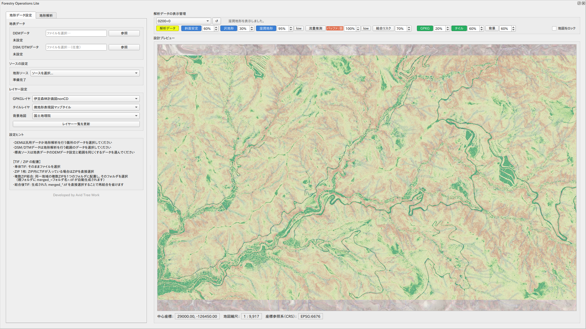
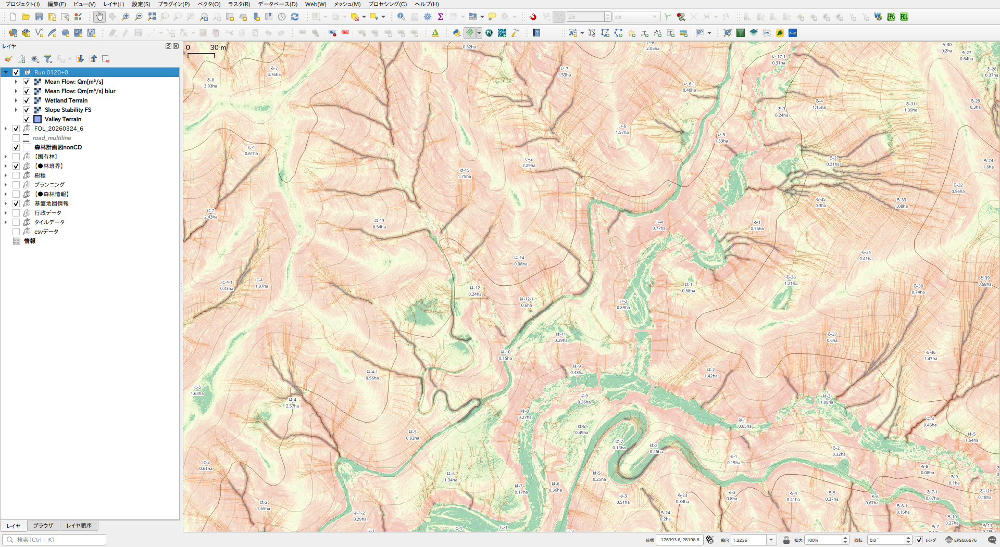

# Forestry Operations Lite

A QGIS plugin for terrain analysis supporting forestry site assessment.



---

## Features

- Load DEM from local files or public services (Japan, the Netherlands, France, New Zealand, and global sources)
- Optional DSM — valid DSM cells refine flow coefficients automatically; missing cells use the specified manual coefficients
- Compute **slope stability** (infinite-slope factor of safety), **TWI** (Topographic Wetness Index), **valley terrain**, and **flow estimation**
- Preview canvas with bidirectional sync to the QGIS main map window
- Layer settings (background / tile / GPKG) displayed in the preview independent of analysis data
- Map lock: fix the preview to the analysis extent while continuing to navigate the main window freely
- Analysis results are grouped and managed by run number in the QGIS layer panel; results to keep can be named under **Named Exports**
- Analysis, DEM/DSM fetching and WebODM Importer export run in the background, so QGIS stays responsive; analysis shows the current step and the estimated time remaining, and switching projects or closing the plugin window cancels a running task and removes its partial files
- Overall Risk and High Risk are selected with **Risk Type** and shown with the same display button; Slope Stability can be overlaid independently
- Preview status bar shows centre coordinates, scale, area (ha), and CRS



---

## Flow Direction Method (Valley / TWI)

The Valley Terrain analysis lets you choose how water flow is routed across the DEM when computing TWI and delineating valley zones. The choice is applied **to the Valley/TWI computation only** — flow estimation always uses D8. The three options trade off between a crisp channel line and a faithful wetness surface.

> ℹ️ **The images below are illustrative comparisons of how each method behaves — not analysis deliverables.** They were rendered on a sample DEM (resampled to 2 m) purely to show the difference; your actual output rasters/vectors are produced by running the analysis.

*Example renders on a sample DEM — for comparison only, not plugin outputs.*

| D8 | D∞ | MFD |
|---|---|---|
|  |  |  |
| **Single steepest** | **D-infinity** | **Multiple flow** |
| Water goes to one neighbour. Crisp single-line channels, but the TWI surface shows **striping artifacts**. | Flow split between two neighbours. **No striping**, valleys stay fairly sharp — a balanced middle ground. | Flow spread to all downslope cells. **Smoothest wetness surface**; valley zones follow the true valley bottom but look wider/fuzzier. |
| Best for **pinpointing where water concentrates** (danger lines, routing roads to avoid channels). | Best when you want **both a readable line and an artifact-free surface**. | Best for reading the **valley terrain itself** as a faithful area (wetness / disaster-risk surface). |

> **Note:** The TWI threshold that best separates valleys differs by method (the accumulation scale changes). Re-check the *TWI Threshold* after switching methods. In the example above, matching valley density required TWI ≈ 5.2 (D8), 5.4 (D∞), 5.9 (MFD).

---

## Named Exports

To keep a result under a recognizable name, select its analysis run and click **Export to Project** (first row of **Analysis Layer Display**, next to the run selector). Enter a name: the default is `Forestry Operations Lite - <run>`, names must be unique, and characters that cannot be used in folder names are rejected with a warning. FOL moves the run folder to `archive/<name>/`, adds its layers to the project as a group with that name, and saves the current display (colours, Filter, opacity) as `.qml` files next to the data. Flow Buffer is not exported.

- The export keeps the display as it was when exported. To change it later, edit the layers directly in QGIS (Layer Properties).
- Named Exports are listed below the analysis runs in the run selector, in the order they were created. Selecting one shows it in the preview in the same way as a run. A Named Export always uses its own display settings (the display saved at export): it does not take over the settings of the analysis runs, and switching back to a run restores the run settings used before the Named Export was selected.
- While a Named Export's group is in the project, **Export to Project** is greyed out. After removing the group from the Layers panel, the button adds it again using the saved `.qml` files.
- Named Exports are not touched by overwrite runs. After the export, FOL copies the analysis DEM into the folder in the background as `elev_relief.tif`, so a Named Export stays complete after its source run or the DEM cache is deleted. This version does not display it; the QGIS 4 version of FOL uses it for Hillshade and Elevation Background.
- Groups exported by earlier versions (named `Forestry Operations Lite - <run>` and referring to the run folder) are left as they are. When that run is exported with Export to Project, those earlier groups are removed from the project and replaced by the new named group. If the project is then closed without saving, the plugin reconnects those groups to the Named Export the next time its window opens and shows a notice. Save the project to keep the new locations.
- FOL has no rename or delete function for Named Exports. Delete `archive/<name>/` in the file manager when it is no longer needed.

---

## Virtual Shizuoka Features (Shizuoka Prefecture, Japan only)

These features use Virtual Shizuoka open data hosted on AWS S3 and are not available outside Shizuoka Prefecture.

- **VS LP/Grid 0.5 m DEM** — auto-fetched from S3 for the current canvas extent
- **Auto DSM** — selecting VS LP/Grid as DEM automatically fetches and sets VS LP/Ground as DSM; no manual DSM selection is needed
- **Export for WebODM Importer** — packages DTM, DSM, ortho, and LAS point cloud into a ZIP for use with the [WebODM Importer](https://github.com/raw-slnc/webodm_importer) plugin

### VS LP/Grid workflow

1. Click **Browse** under DEM Data and select **VS LP/Grid (0.5m)**
2. DEM tiles are fetched from S3 for the current canvas extent
3. Immediately after, DSM (VS LP/Ground LAS → GeoTIFF) is fetched automatically for the same extent
4. The DSM browse button is disabled while VS LP/Grid is active (DSM is managed automatically)
5. **Cancel** on the DEM row cancels both DEM and DSM operations
6. **Clear** on the DEM row clears both DEM and DSM

### Export for WebODM Importer

The **Export for WebODM Importer** section packages the loaded VS LP terrain data into a ZIP that the WebODM Importer plugin can load directly.

**Requirements:**
- WebODM Importer plugin must be installed (controls are disabled otherwise)
- DEM source must be VS LP/Grid (DSM is set automatically)

**What is included in the ZIP:**
- DTM — VS LP/Grid GeoTIFF (0.5 m)
- DSM — VS LP/Ground converted from LAS (0.5 m)
- Ortho — VS LP/Ortho tiles for the same tile range as DEM/DSM (skipped if not available)
- LAS point cloud — not included in the ZIP; `las_sources.json` refers to the LAS files used to create the DSM (`vs_lp_ground/`), and `README_LAS_LINKS.txt` lists their download URLs

All data is fetched for the same tile range (determined at DEM load time), ensuring geographic consistency.

Use the **Open in WODMI** button to open the exported ZIP directly in the WebODM Importer panel.

---

## DEM Sources

| Source | Coverage | Resolution | Notes |
|--------|----------|------------|-------|
| GSI DEM1A | Japan | ~1 m | Auto-fetched from canvas extent |
| GSI DEM5A | Japan | ~5 m | Auto-fetched from canvas extent |
| GSI DEM10B | Japan | ~10 m | Auto-fetched from canvas extent |
| AWS Terrarium | Worldwide | ~2–10 m eq. | Auto-fetched from canvas extent |
| AHN4 DTM / DSM | Netherlands | 0.5 m | Auto-fetched from PDOK for the canvas extent |
| IGN LiDAR HD MNT / MNS | France | 0.5 m | Auto-fetched from Geoplateforme; coverage is still incomplete |
| LINZ DEM | New Zealand | 1 m | Read from public COGs; requires GDAL LERC support |
| Local file | Any | As-is | GeoTIFF, ZIP, or folder |
| Copernicus GLO-30 | Worldwide | 30 m | Free account required (OpenTopography) |
| VS LP/Grid | Shizuoka Pref., Japan | 0.5 m | Auto-fetched from S3 — see Virtual Shizuoka Features |

AHN and IGN automatically fetch their paired DSM after the DEM. DSM values are aligned to the final analysis DEM grid. Cells without valid DSM coverage fall back to the Runoff and Velocity coefficients shown in the panel, and the applied coverage is recorded in `params.json` and Analysis Conditions. If DSM preparation fails, choose Retry, Continue without DSM, or Cancel.

Fetched AHN, IGN, and LINZ files are stored in `remote_dem/`. When a file fetched earlier from the same source already covers the required extent, it is reused without downloading again. Cached DEM/DSM files are kept while a saved analysis references them or they are currently loaded, and cache cleanup removes them after they are no longer referenced.

The WebODM Importer export remains a Virtual Shizuoka-only function. AHN, IGN, and LINZ data are not included in that export.

### Re-fetching before analysis

For auto-fetched DEM sources, the analysis uses the DEM already fetched. Only when the analysis area extends beyond it does the plugin ask whether to fetch it again; confirming re-fetches the DEM (and the DSM, if set) and then runs the analysis. Local DEM files are analysed on the overlapping part without asking.

### CRS recommendations

- Set the project CRS to the **UTM zone** covering your analysis area for best accuracy.
- UTM is valid up to ±84° latitude. Accuracy degrades above ±70° (Arctic/Antarctic regions are outside the intended use range).
- The plugin automatically corrects cell size for geographic CRS (EPSG:4326) and Web Mercator (EPSG:3857) inputs.

**UTM zone examples:**

| Region | Recommended CRS |
|--------|----------------|
| Japan (126–132°E) | EPSG:32653 |
| Japan (132–138°E) | EPSG:32654 |
| Japan (138–144°E) | EPSG:32655 |
| Peru / Bolivia (66–72°W) | EPSG:32719 |
| Peru / Bolivia (72–78°W) | EPSG:32718 |
| Southeast Asia | UTM zone for longitude |

---

## Requirements

- QGIS 3.16 or later
- Python 3.7+
- numpy, GDAL (bundled with QGIS)
- scipy — bundled on Windows (standard installer); **not bundled on Linux**.
  Needed only for Flow Buffer display, fine-resolution DEM resampling, and SHC computation
  (other features work without it). See the in-panel guide (Data Setup tab) or `data/FOL.html`
  for install steps if it's missing.

---

## Installation

1. Download the ZIP from [Releases](https://github.com/raw-slnc/forestry_operations_lite/releases)
2. In QGIS: **Plugins > Manage and Install Plugins > Install from ZIP**
3. The plugin appears in the **Raster toolbar** and **Raster menu**

---

## Usage

1. Click the **FOL** icon in the Raster toolbar to open the plugin window
2. Select a DEM source under **Terrain Data**
3. Set background / tile / GPKG layers under **Layer Settings**
4. Run terrain analysis — results are added to the QGIS layer panel grouped by run number
5. Toggle analysis layers on/off using the buttons in the preview panel
6. Use **Risk Type** to switch the Overall Risk button between Overall Risk and High Risk display

---

## Output Folder Structure

All output is written to `{project_folder}/forestry_operations_lite/`.
If the QGIS project has not been saved, `~/.qgis/forestry_operations_lite/` is used as a fallback.

```
forestry_operations_lite/
│
├── dem/                          # GSI / Terrarium tiles (GeoTIFF)
│   ├── gsi_dem5a_YYYYMMDD_HHMMSS.tif
│   └── gsi_dem5a_YYYYMMDD_HHMMSS_utm53.tif   ← reprojected to UTM
│
├── remote_dem/                   # AHN / IGN / LINZ DEM and DSM GeoTIFFs
│
├── vs_lp_grid/                   # VS LP/Grid DEM tiles — Shizuoka only (GeoTIFF)
│   ├── {tile_code}.tif
│   └── vs_grid_YYYYMMDD_HHMMSS.tif           ← merged (multi-tile)
│
├── vs_lp_ground/                 # VS LP/Ground DSM tiles — Shizuoka only
│   ├── {tile_code}.las                        ← raw LAS point cloud
│   ├── {tile_code}_dsm.tif                   ← converted DSM
│   └── vs_dsm_YYYYMMDD_HHMMSS.tif            ← merged (multi-tile)
│
├── zip/                          # Export ZIPs for WebODM Importer — Shizuoka only
│   ├── FOL_YYYYMMDD-all.zip
│   └── FOL_YYYYMMDD_2-all.zip                ← sequential if same day
│
├── archive/                      # Named Exports
│   └── {name}/                   ← moved run folder with .qml styles and fol_archive.json
│
└── {run_number}/                 # Analysis results (e.g. 0011, 0012, 0010+2)
    ├── params.json               ← analysis parameters
    ├── stability_fs.tif          ← slope stability factor of safety
    ├── unstable_zones.gpkg       ← FS < threshold polygons
    ├── twi.tif                   ← Topographic Wetness Index
    ├── valley_zones.gpkg         ← valley / wetland zones (TWI threshold)
    ├── tc.tif                    ← time of concentration [h]
    ├── flow_peak.tif             ← peak discharge Qp [m³/s]
    ├── flow_mean.tif             ← mean discharge Qm [m³/s]
    ├── integrated_risk_index.tif ← overall risk index (auto-generated)
    └── integrated_high_risk.gpkg ← high-risk area polygons
```

**Run number format:** `{seq:3d}{n_files:1d}` (e.g. `0011` = run 001, 1 file).
When more than 9 files: `{seq}0+{n-10}` (e.g. `0010+2` = run 001, 12 files).


---

## License

This project is licensed under the GNU General Public License v2 or later.

The plugin bundles two third-party libraries in `vendor/`, each under its own license: laspy 2.7.0 (BSD 2-Clause, `vendor/laspy/LICENSE.txt`) and defusedxml 0.7.1 (Python Software Foundation License Version 2, `vendor/defusedxml/LICENSE`). Their sources and the changes made to them are listed in `vendor/README.md`.

---

## Support

If you find this plugin useful, your support is appreciated.
https://paypal.me/rawslnc

---

---

# Forestry Operations Lite（日本語）

林業サイトの地形解析を支援するQGISプラグインです。

---

## 機能

- ローカルファイルまたは公開サービス（日本・オランダ・フランス・ニュージーランド・全球ソース）からDEMを読み込み
- DSMオプション — 有効なDSMセルは流出係数・流速係数に反映し、欠損セルは画面の手動係数で補完
- **斜面安定性**（無限斜面安全率）・**TWI**（地形湿潤指数）・**沢地形**・**流量推測**を計算
- QGISメインマップとの双方向同期プレビューキャンバス
- 解析データの有無に関わらず、レイヤー設定（背景・タイル・GPKG）をプレビューに表示
- 地図ロック：解析範囲にプレビューを固定しながら、メインウィンドウは自由に操作可能
- 解析結果はQGISレイヤーパネルに解析番号グループで管理。残したい結果は名前を付けて **Named Exports** で管理
- 解析・DEM/DSMの取得・WebODM Importer向け書き出しはバックグラウンドで行い、QGISの操作を止めない。解析中は現在の段階と残り時間の目安を表示し、プロジェクトの切り替えやプラグインの窓を閉じると実行中の処理を中止して途中のファイルを削除
- Overall Risk と High Risk は **Risk Type** で選択し、同じ表示ボタンで切替表示。Slope Stability は独立して重ね表示できます
- プレビューステータスバーに中心座標・縮尺・面積（ha）・CRSを表示

---

## 沢地形の流向方式（Valley / TWI）

沢地形（Valley Terrain）解析では、TWI計算と沢ゾーン抽出のときに**水の流し方（流向方式）**を選べます。この選択は**沢地形（TWI）にのみ**適用され、流量推測は常にD8です。3方式は「沢の線のくっきりさ」と「湿り分布の正確さ」のトレードオフになります。

> ℹ️ **下の画像は各方式の挙動の違いを示す説明用の比較図であり、解析成果物ではありません。** 違いを示すためだけにサンプルDEM（2mリサンプル）で描画したものです。実際の出力ラスタ／ベクタは解析を実行して生成されます。

*サンプルDEMでの描画例 — 比較用であり、プラグインの成果物ではありません。*

| D8 | D∞ | MFD |
|---|---|---|
|  |  |  |
| **単一最急（1方向）** | **D∞（Tarboton）** | **多方向（MFD）** |
| 水を1マスにだけ流す。沢が細い1本線でくっきり出るが、TWI面に**縦縞のアーティファクト**が出る。 | 隣接2マスに分けて流す。**縞が出ず**、沢の線もそこそこ残る中間型。 | 下り方向すべてに分配。**最もなめらかな湿り分布**。沢ゾーンは実際の谷底に沿うが太く曖昧に見える。 |
| **水が集まる危険筋を特定**したいとき（崩れやすい筋・道で避ける筋の把握）に向く。 | **線も残しつつ縞のない面**が欲しいときに向く。 | **沢地形そのものを面として正確に**見たいとき（湿り・災害リスク面）に向く。 |

> **注意：** 沢をうまく分ける最適なTWI閾値は方式ごとにズレます（集水のスケールが変わるため）。方式を切り替えたら *TWI Threshold* を再調整してください。上図では沢の量を揃えるのに TWI ≈ 5.2（D8）・5.4（D∞）・5.9（MFD）が必要でした。

---

## Named Exports

結果を分かりやすい名前で残すときは、解析番号を選んで **Export to Project**（**Analysis Layer Display** の1行目、解析番号の選択欄の隣）を押します。名前を入力します。初めは `Forestry Operations Lite - <解析番号>` が入っています。名前は重複できず、フォルダ名に使えない文字は注意が出て使えません。FOLは解析番号のフォルダを `archive/<名前>/` へ移し、そのレイヤーを同じ名前のグループとしてプロジェクトに追加し、今の表示（配色・Filter・不透明度）をデータの隣に `.qml` として保存します。Flow Buffer は書き出しません。

- 書き出したときの表示をそのまま残します。あとで変えるときは、QGIS でレイヤーを直接編集してください（レイヤーのプロパティ）。
- Named Exports は、解析番号の選択欄で解析番号の下に、作った順に並びます。選ぶと、解析番号と同じようにプレビューに表示します。Named Export は常に自分の表示の設定（書き出したときの表示）を使います。解析番号の設定を引き継がず、解析番号に戻ると、Named Export を選ぶ前の解析番号の設定に戻ります。
- Named Export のグループがプロジェクトにある間は、**Export to Project** はグレーになります。レイヤーパネルからグループを外すと、保存済みの `.qml` を使ってもう一度追加できます。
- Named Exports は上書き解析の対象になりません。書き出したあと、FOL は解析の DEM をバックグラウンドでフォルダに `elev_relief.tif` として写します。元の解析や DEM キャッシュを削除しても Named Export はそろったまま使えます。この版では表示しません。QGIS 4 版の FOL が Hillshade と Elevation Background に使います。
- 以前の版で書き出したグループ（`Forestry Operations Lite - <解析番号>` で、解析番号のフォルダを参照しているもの）は、そのまま使えます。その解析番号を Export to Project で書き出すと、以前のグループはプロジェクトから外し、名前を付けたグループに置き換えます。そのあと保存せずにプロジェクトを閉じた場合は、次にプラグインの窓を開いたときに Named Export へ付け直し、お知らせを出します。新しい場所を残すため、プロジェクトを保存してください。
- FOL には Named Exports の名前の変更・削除の機能はありません。不要になったら、ファイルマネージャで `archive/<名前>/` を削除してください。

---

## バーチャル静岡機能（静岡県限定）

AWS S3上のバーチャル静岡オープンデータを使用する機能です。静岡県外では利用できません。

- **VS LP/Grid 0.5m DEM** — 現在のキャンバス範囲のタイルをS3から自動取得
- **DSM自動設定** — DEMにVS LP/Gridを選択すると、VS LP/GroundがDSMとして自動取得・設定される（手動でのDSM選択は不要）
- **Export for WebODM Importer** — DTM・DSM・オルソ・LAS点群を [WebODM Importer](https://github.com/raw-slnc/webodm_importer) プラグイン向けZIPにエクスポート

### VS LP/Grid ワークフロー

1. DEM Data の **Browse** をクリックし、**VS LP/Grid (0.5m)** を選択
2. 現在のキャンバス範囲に対してS3からDEMタイルを取得
3. 取得完了後、同じ範囲のDSM（VS LP/Ground LAS → GeoTIFF）を自動取得
4. VS LP/Grid 使用中はDSM Browseボタンが無効（DSMは自動管理）
5. **DEM行のCancel** でDEM・DSM両方の処理をキャンセル
6. **DEM行のClear** でDEM・DSM両方をクリア

### Export for WebODM Importer

**Export for WebODM Importer** セクションでは、読み込み済みのVS LP地形データを [WebODM Importer](https://github.com/raw-slnc/webodm_importer) プラグインが直接読み込めるZIP形式にパッケージ化できます。

**使用条件：**
- WebODM Importer プラグインがインストールされていること（未インストール時はすべての操作が無効）
- DEMソースがVS LP/Gridであること（DSMは自動設定）

**ZIPに含まれるデータ：**
- DTM — VS LP/Grid GeoTIFF（0.5 m）
- DSM — VS LP/Ground からLAS変換したGeoTIFF（0.5 m）
- Ortho — DEM読込時と同じタイル範囲のVS LP/Ortho（対象外エリアはスキップ）
- LAS点群 — ZIPには入れません。DSM作成に使ったLAS（`vs_lp_ground/`）を `las_sources.json` で参照し、`README_LAS_LINKS.txt` にダウンロードURLを記載します

DEM読込時のタイル範囲に基づいて全データが取得されるため、地理的整合性が保たれます。

**Open in WODMI** ボタンを押すと、エクスポートしたZIPをWebODM Importerパネルで直接開けます。

---

## DEMソース

| ソース | カバレッジ | 解像度 | 備考 |
|--------|-----------|--------|------|
| 国土地理院 DEM1A | 日本 | 約1 m | キャンバス範囲から自動取得 |
| 国土地理院 DEM5A | 日本 | 約5 m | キャンバス範囲から自動取得 |
| 国土地理院 DEM10B | 日本 | 約10 m | キャンバス範囲から自動取得 |
| AWS Terrarium | 全球 | 約2〜10 m相当 | キャンバス範囲から自動取得 |
| AHN4 DTM / DSM | オランダ | 0.5 m | PDOKからキャンバス範囲を自動取得 |
| IGN LiDAR HD MNT / MNS | フランス | 0.5 m | Geoplateformeから自動取得。未整備地域あり |
| LINZ DEM | ニュージーランド | 1 m | 公開COGから読み込み。GDALのLERC対応が必要 |
| ローカルファイル | 任意 | 元データ準拠 | GeoTIFF・ZIP・フォルダ |
| Copernicus GLO-30 | 全球 | 30 m | 無料アカウント必要（OpenTopography） |
| VS LP/Grid | 静岡県 | 0.5 m | S3から自動取得 — バーチャル静岡機能参照 |

AHNとIGNはDEM取得後に対応するDSMも自動取得します。DSMは最終的な解析DEMグリッドに合わせ、有効値のないセルは画面のRunoff・Velocity係数で補完します。適用範囲は`params.json`とAnalysis Conditionsに記録されます。DSM準備に失敗した場合は、再試行・DSMなしで続行・中止を選択できます。

取得したAHN・IGN・LINZのファイルは`remote_dem/`に保存します。同じソースで前に取得したファイルが必要な範囲を覆っていれば、再ダウンロードせずに再利用します。保存済み解析から参照されている、または現在読み込み中のDEM/DSMは保持し、参照されなくなったファイルはキャッシュ整理で削除します。

WebODM Importer向けエクスポートは従来どおりバーチャル静岡専用です。AHN・IGN・LINZのデータはこのエクスポートに含まれません。

### 解析前の再取得

自動取得型の DEM は、取得済みの DEM で解析します。解析範囲がその外に出るときだけ再取得するかを確認し、確認すると DEM（DSM がセットされていれば DSM も）を取り直してから解析します。ローカルの DEM ファイルは確認なしで重なる部分を解析します。

### CRS推奨

- 解析精度を高めるため、プロジェクトCRSを対象地域の**UTMゾーン**に設定してください。
- UTMは緯度±84°まで定義されています。±70°を超える高緯度（北極・南極圏）は想定使用範囲外です。
- 地理座標系（EPSG:4326）・Web Mercator（EPSG:3857）のDEMを使用する場合、セルサイズは自動補正されます。

**UTMゾーン例：**

| 地域 | 推奨CRS |
|------|---------|
| 日本（東経126〜132°） | EPSG:32653 |
| 日本（東経132〜138°） | EPSG:32654 |
| 日本（東経138〜144°） | EPSG:32655 |
| ペルー・ボリビア（西経66〜72°） | EPSG:32719 |
| ペルー・ボリビア（西経72〜78°） | EPSG:32718 |
| 東南アジア | 経度に対応するUTMゾーン |

---

## 動作環境

- QGIS 3.16 以降
- Python 3.7+
- numpy、GDAL（QGIS同梱）
- scipy — Windows（標準インストーラー）では同梱済み。**Linuxでは同梱されていません**。
  Flow Buffer表示・高解像度DEMのリサンプル・SHC計算にのみ必要です（他の機能には影響しません）。
  無い場合のインストール手順はパネル内の案内（Data Setupタブ）または`data/FOL.html`を参照してください。

---

## インストール

1. [Releases](https://github.com/raw-slnc/forestry_operations_lite/releases) からZIPをダウンロード
2. QGISで **プラグイン > プラグインの管理とインストール > ZIPからインストール**
3. **ラスターツールバー**および**ラスターメニュー**にプラグインが追加されます

---

## 使い方

1. ラスターツールバーの **FOL** アイコンをクリックしてプラグインウィンドウを開く
2. **Terrain Data** でDEMソースを選択
3. **レイヤー設定** で背景・タイル・GPKGレイヤーを設定
4. 地形解析を実行 — 解析結果は解析番号グループとしてQGISレイヤーパネルに追加
5. プレビューパネルのボタンで解析レイヤーの表示/非表示を切替
6. **Risk Type** で Overall Risk ボタンの表示対象を Overall Risk / High Risk に切り替え

---

## 出力フォルダ構造

すべての出力は `{プロジェクトフォルダ}/forestry_operations_lite/` に書き込まれます。
QGISプロジェクトが未保存の場合は `~/.qgis/forestry_operations_lite/` にフォールバックします。

```
forestry_operations_lite/
│
├── dem/                          # 国土地理院 / Terrarium タイル（GeoTIFF）
│   ├── gsi_dem5a_YYYYMMDD_HHMMSS.tif
│   └── gsi_dem5a_YYYYMMDD_HHMMSS_utm53.tif   ← UTMに再投影済み
│
├── remote_dem/                   # AHN / IGN / LINZ のDEM・DSM GeoTIFF
│
├── vs_lp_grid/                   # VS LP/Grid DEMタイル（静岡限定・GeoTIFF）
│   ├── {タイルコード}.tif
│   └── vs_grid_YYYYMMDD_HHMMSS.tif           ← マージ済み（複数タイル）
│
├── vs_lp_ground/                 # VS LP/Ground DSMタイル（静岡限定）
│   ├── {タイルコード}.las                     ← 生LAS点群
│   ├── {タイルコード}_dsm.tif               ← 変換済みDSM
│   └── vs_dsm_YYYYMMDD_HHMMSS.tif            ← マージ済み（複数タイル）
│
├── zip/                          # WebODM Importer向けエクスポートZIP（静岡限定）
│   ├── FOL_YYYYMMDD-all.zip
│   └── FOL_YYYYMMDD_2-all.zip                ← 同日2回目以降
│
├── archive/                      # Named Exports
│   └── {名前}/                   ← 移した解析フォルダ（.qml スタイルと fol_archive.json 付き）
│
└── {解析番号}/                   # 解析結果（例: 0011, 0012, 0010+2）
    ├── params.json               ← 解析パラメータ
    ├── stability_fs.tif          ← 斜面安定性（安全率）
    ├── unstable_zones.gpkg       ← 不安定ゾーンポリゴン（FS < 閾値）
    ├── twi.tif                   ← 地形湿潤指数（TWI）
    ├── valley_zones.gpkg         ← 沢地形・湿潤ゾーンポリゴン（TWI閾値）
    ├── tc.tif                    ← 到達時間 Tc [h]
    ├── flow_peak.tif             ← ピーク流量 Qp [m³/s]
    ├── flow_mean.tif             ← 平均流量 Qm [m³/s]
    ├── integrated_risk_index.tif ← 統合リスク指標（自動生成）
    └── integrated_high_risk.gpkg ← 高リスクエリアポリゴン
```

**解析番号フォーマット：** `{連番3桁}{ファイル数1桁}`（例: `0011` = 第1回解析・1ファイル）
ファイル数が10以上の場合: `{連番}0+{n-10}`（例: `0010+2` = 第1回解析・12ファイル）


---

## サポート

開発を応援していただけると嬉しいです。
https://paypal.me/rawslnc

## ライセンス

GNU General Public License v2 以降

プラグインは `vendor/` に2つの外部ライブラリを同梱しており、それぞれ元のライセンスに従います：laspy 2.7.0（BSD 2-Clause、`vendor/laspy/LICENSE.txt`）、defusedxml 0.7.1（Python Software Foundation License Version 2、`vendor/defusedxml/LICENSE`）。配布元と手を加えた点は `vendor/README.md` に記載しています。

## 作者

Copyright (C) 2026 Hideharu Masai
